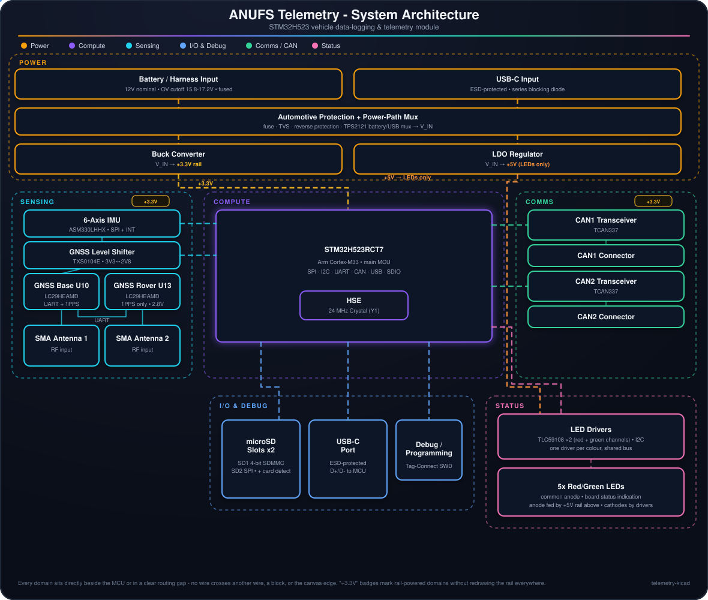

# ANUFS Telemetry

  

STM32H5-based data-logging and telemetry module for the ANUFS vehicle. It sits on two of the car's CAN buses, fuses IMU + dual-antenna GNSS data with bus traffic, logs everything to two microSD cards, drives onboard status LEDs, and exposes USB-C for bench debug.

Reference designators below come from the current netlist (`telemetry.net`, exported 2026-10-13).

## Architecture

- **Power** - the board runs from the vehicle's 12V harness input (`J1`), through `D2` (SMBJ16A TVS) and `F1` (1.5A polyfuse), then `Q1` (P-FET reverse-polarity protection, gate clamped by `D1`) into `U2` (TPS2121), which arbitrates between that battery feed and USB-C bus power (via `D3`) so the board can run on the bench without the car. The over-voltage lockout on the battery input is set by the `U2` OV1 divider (`R10` 73.2k / `R12` 5k). The muxed rail (`V_IN`) feeds two independent regulators: `U1` (LMR33610) bucks it to the **+3.3V rail that powers everything else on the board**, while `U5` (LM2940-5.0) makes a separate **+5V rail that goes only to the status LEDs' common anodes**.
- **Compute** - `U6`, an STM32H523RCT7 (Cortex-M33), is the hub. It is clocked from a 24MHz crystal (`Y1`). `SW3` is the NRST button and `SW4` pulls BOOT0 high (with `R34` pull-down) for the system bootloader.
- **Sensing** - `U3` (ASM330LHHX) is a 6-axis IMU wired to the MCU over SPI (CS, SCK, SDI, SDO), with INT1/INT2 back to the MCU (its MSDA/MSCL pins are tied to GND).
- **GNSS** - two Quectel LC29HEAMD modules form a dual-antenna moving-base heading pair:
  - `U10` is the **moving base**. It is the only module with a data link to the MCU: UART1 (TXD1/RXD1) and 1PPS go through `U12` (TXS0104E) because the module runs its digital I/O at 2.8V (`VDD_EXT_1`).
  - `U13` is the **rover**. Its only connection to the MCU is its 1PPS output (also through `U12`). It talks to `U10` on the `CORRECTION` (U10 pin 18 to U13 pin 21) and `HEADING` (U13 pin 20 to U10 pin 19) nets, and its reset (`GNSS_RESET_SLAVE`) is driven from U10 pin 17.
  - The MCU resets `U10` through `Q2` (MMBT3904, driven by `GNSS_RESET_ASSERT` via `R37`).
  - Each module has its own SMA (`J7` for U10, `J8` for U13) with a bias-tee for an active antenna (see [antenna doc](active_antenna_addition_BOM.md)). `J9`/`J10` are two further SMAs joined only to each other on net `ANT3` (RF test through-path, not connected to either module).
- **Comms** - two independent `TCAN337` transceivers (`U4`, `U7`) put the MCU on two CAN buses in parallel, broken out to `J4` (CAN1) and `J5` (CAN2).
- **Storage** - two microSD slots. `J3` (SD1) has CMD, CLK, D0-D3 and card-detect all routed to the MCU. `J11` (SD2) routes only CMD, CLK, D0, D3/CS and card-detect to the MCU; its DAT1 and DAT2 lines go to pull-ups only.
- **I/O & debug** - USB-C (`J6`, ESD-protected by `U11` USBLC6) is the bench data/debug link (D+/D- to the MCU). `J2` is a Tag-Connect TC2030 SWD port (SWDIO, SWCLK, NRST, SWO); `J12` is an alternative 1x04 SWD header on the same nets, not fitted (DNP) - only one of J2/J12 is ever installed. `SW1` and `SW2` are three-pin user switches (nets `SW_A`..`SW_D` to MCU pins PC0..PC3).
- **Status** - five bi-colour LEDs (`LED1`..`LED5`, XL-2012SURUGC) with common anodes on the +5V rail. Two `TLC59108` I2C drivers each sink one cathode channel per LED: `U9` drives nets `LED0`..`LED4` (LED pin 3 of each part) and `U8` drives `LED5`..`LED9` (LED pin 1 of each part), so the two colours are independently addressable per LED. `U8` has A0-A3 tied low and `U9` has A0 tied to +3.3V (A1-A3 low), giving them different I2C addresses. Both share SDA/SCL (4.7k pull-ups) and a common reset line driven by the MCU.

The diagram above is a live SVG: dashed lines are active power/signal paths and the small dots trace the direction of flow through each domain (open `assets/architecture.svg` directly if your viewer doesn't animate it).

## MCU pin map (U6, STM32H523RCT7, LQFP64)

Package pin numbers and nets as exported in `telemetry.net`. Alternate-function selection is not listed here; check it against the ST datasheet when configuring peripherals.

| Function | Signal (net) | MCU pin (package pin) |
|---|---|---|
| Crystal | CYST_IN / CYST_OUT | PH0 (5) / PH1 (6) |
| Reset | NRST | NRST (7) |
| Boot | BOOT0 | BOOT0 (60) |
| SWD | SWDIO / SWCLK / SWO | PA13 (46) / PA14 (49) / PB3 (55) |
| USB | D- / D+ | PA11 (44) / PA12 (45) |
| User switches | SW_A / SW_B / SW_C / SW_D | PC0 (8) / PC1 (9) / PC2 (10) / PC3 (11) |
| GNSS U10 UART | RXD1_GNSS / TXD1_GNSS (MCU-side names) | PA0 (14) / PA1 (15) |
| GNSS 1PPS | TIMERIN_GNSS_1 (U10) / TIMERIN_GNSS_2 (U13) | PA9 (42) / PA3 (17) |
| GNSS reset | GNSS_RESET_ASSERT (to Q2 base) | PC6 (37) |
| IMU | CS_IMU / SCK_IMU / DO_IMU / DI_IMU | PA4 (20) / PA5 (21) / PA6 (22) / PA7 (23) |
| IMU interrupts | INT1 / INT2 | PC4 (24) / PC5 (25) |
| CAN1 | TXD_CAN1 / RXD_CAN1 / FLT_CAN1 | PB7 (59) / PB8 (61) / PB6 (58) |
| CAN2 | TXD_CAN2 / RXD_CAN2 / FLT_CAN2 / SIL_CAN2 | PB13 (34) / PB12 (33) / PB10 (29) / PA10 (43) |
| SD1 (J3) | D0 / D1 / D2 / D3 | PC8 (39) / PC9 (40) / PC10 (51) / PC11 (52) |
| SD1 (J3) | CLK / CMD / DET | PC12 (53) / PD2 (54) / PC7 (38) |
| SD2 (J11) | D0 / D3 (CS) / CLK / CMD / DET | PB14 (35) / PB0 (26) / PB2 (28) / PB15 (36) / PB1 (27) |
| LED drivers | SCL_LED / SDA_LED / RST_LED | PA8 (41) / PB4 (56) / PB5 (57) |
| Unconnected | PC13, PC14, PC15, PA2, PA15 | 2, 3, 4, 16, 50 |

## Repo contents

- [KiCad project](telemetry-kicad/telemetry.kicad_pro)
- [Schematic](telemetry-kicad/telemetry.kicad_sch)
- [PCB layout](telemetry-kicad/telemetry.kicad_pcb)
- [Netlist](telemetry.net)
- [JLCPCB gerbers](telemetry-kicad/JLCPCB_gerbers) and [fab zip](telemetry-kicad/telemetry-JLCPCB.zip)
- [Bill of materials](TELEMETRY_DigiKey_BOM.xlsx)
- [Power budget](telemetry_power_budget.xlsx) (stale: it predates the second GNSS module and SD2)
- [Active antenna and dual-antenna heading notes](active_antenna_addition_BOM.md)
- [RF analysis](RF%20Analysis/STATUS.md)
- [Firmware / software](../software)
